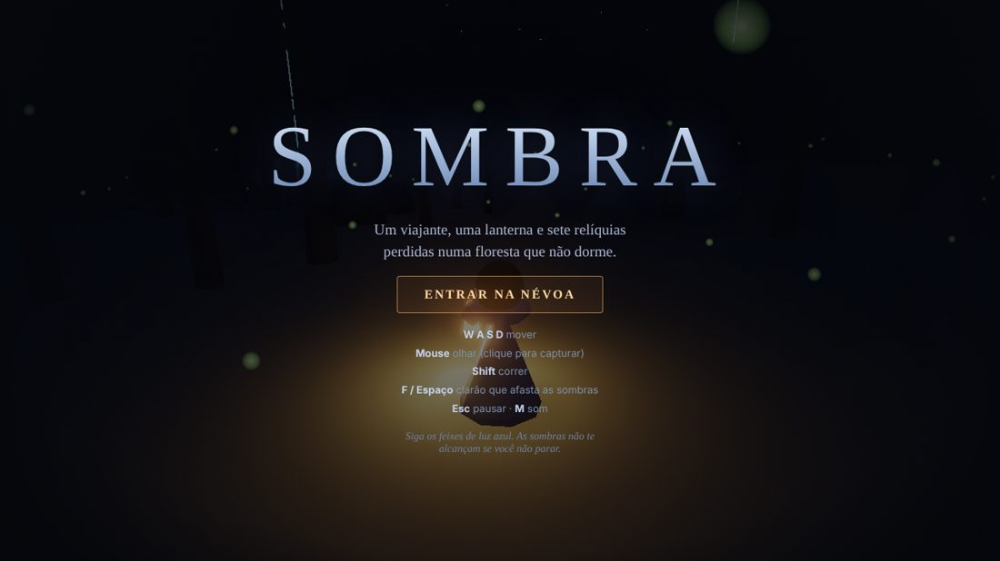
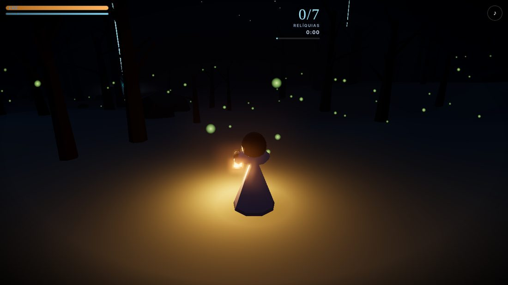
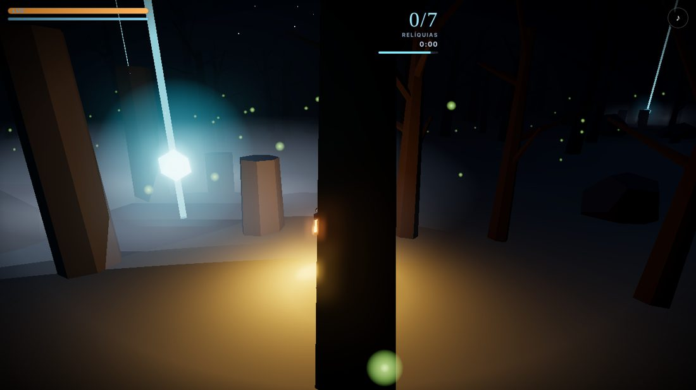
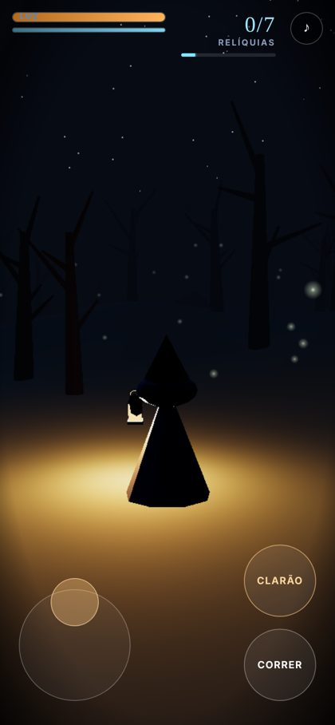

# Sombra · estudo de three.js

Jogo de exploração em 3D que roda direto no navegador, feito para **testar o three.js** fora do portfólio e entender até onde dá para levar uma experiência interativa só com código: sem modelos 3D, sem texturas e sem arquivos de áudio.

Você é um viajante encapuzado com uma lanterna, perdido numa floresta enevoada. Há **sete relíquias** escondidas em santuários antigos, e sombras que rondam a escuridão.





## Por que este projeto existe

Quero transformar meu portfólio em algo mais interativo. Antes de mexer no site, fiz este laboratório para aprender o three.js na prática: iluminação, névoa, geometria procedural, pós-processamento, entrada por teclado e toque, e áudio sintetizado. O que funcionar aqui pode voltar ao portfólio como cenas e efeitos.

## Como o jogo foi criado

1. **Experimento 1, Neon Runner** (`experimentos/neon-runner`): um corredor de três pistas, só para pegar o ritmo da biblioteca: cena, câmera, laço de animação, colisão e HUD.
2. **Experimento 2, Sombra** (este projeto): mudei o rumo para exploração de mundo aberto num clima sombrio, o que exigiu terreno, iluminação dinâmica, inimigos, áudio e controles para computador e celular.

## Como funciona

| Parte | Técnica |
| --- | --- |
| Terreno | Ruído fractal (fbm) calculado no código; a mesma função de altura serve para desenhar o chão e para colar personagem, câmera e objetos nele |
| Árvores, rochas, túmulos, pilares | `InstancedMesh`: centenas de objetos com poucas chamadas de desenho |
| Atmosfera | `FogExp2`, luz da lua, estrelas e lua que acompanham a câmera, vaga-lumes, névoa baixa nos santuários, bloom (`UnrealBloomPass`) |
| Personagem | Montado com primitivas, com lanterna e `PointLight` que oscila e enfraquece conforme a luz diminui |
| Sombras (inimigos) | Perseguem dentro de um raio, ficam mais rápidas a cada relíquia; o clarão as atordoa e afasta |
| Orientação | Feixes de luz visíveis de longe e um indicador de proximidade da relíquia mais próxima |
| Áudio | Web Audio API: vento, drone, passos, sussurros e zumbido que variam com a situação, sem nenhum arquivo |
| Controles | Teclado e mouse (pointer lock), joystick virtual e gestos no celular |
| Qualidade | Em telas de toque o bloom é desligado e a resolução é limitada |



## Como jogar



| Ação | Computador | Celular |
| --- | --- | --- |
| Mover | W A S D | Joystick à esquerda |
| Olhar | Mouse (clique para capturar) | Arrastar à direita |
| Correr | Shift | Botão Correr |
| Clarão | F ou Espaço | Botão Clarão |
| Pausar / som | Esc / M | Botão de som |

Colete as 7 relíquias para vencer. Se a luz chegar a zero, a escuridão vence. O melhor tempo fica salvo no aparelho.

## Rodando localmente

Requer Node.js 18 ou superior.

```bash
npm install
npm run dev      # http://localhost:5173
npm run build    # saída em dist/
```

## Estrutura

```
src/
├── main.js        interface, HUD, telas e controles de toque
├── game.js        cena, laço do jogo, câmera, entrada e inimigos
├── world.js       terreno procedural, props, santuários e relíquias
├── character.js   viajante e sombras
├── audio.js       áudio sintetizado
└── noise.js       ruído e gerador pseudoaleatório com semente
experimentos/
└── neon-runner/   primeiro teste: corredor 3D
```

## Limitações conhecidas

- Testado em navegador desktop e em emulação de celular; ainda falta validar o desempenho em aparelhos reais.
- A dificuldade foi ajustada só por testes automáticos; falta jogar bastante para equilibrar.
- O mundo é fixo (mesma semente a cada partida).

## Próximos passos

- Mundo gerado a cada partida e mais tipos de ambiente.
- Mais comportamentos para as sombras e novos itens.
- Levar cenas e efeitos para o portfólio.

## Tecnologias

three.js · Vite · JavaScript · Web Audio API
